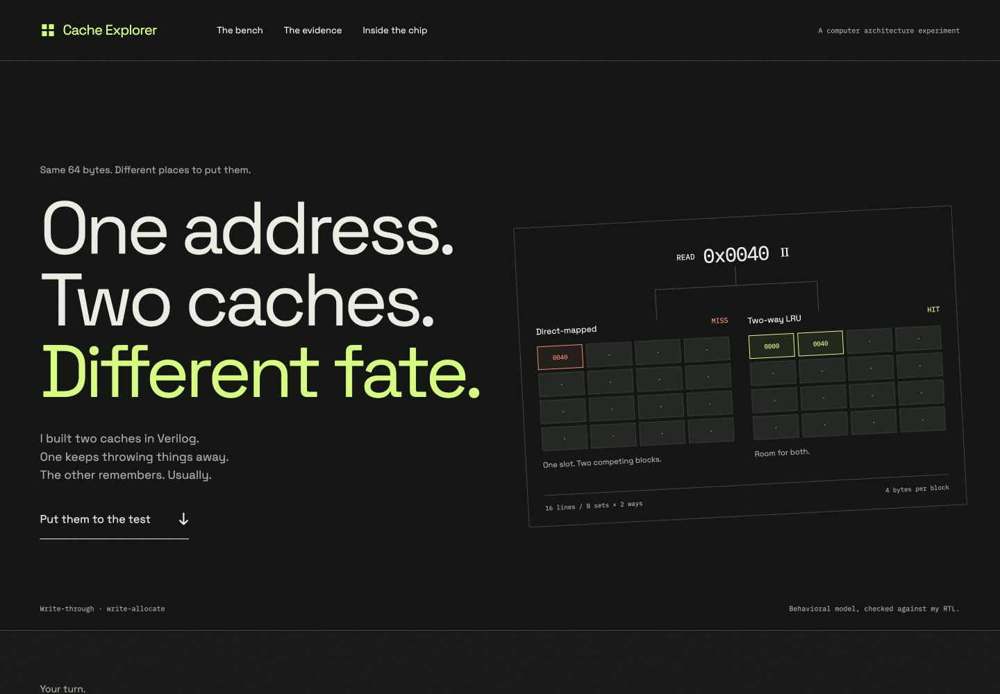

# 2-Way Set-Associative Cache with LRU

A small Verilog cache project with an interactive **Cache Explorer** website.
It compares a direct-mapped cache and a two-way set-associative cache with
least-recently-used replacement, using identical memory requests.



## Cache design

| Setting | Direct-mapped | Two-way LRU |
| --- | --- | --- |
| Data capacity | 64 bytes | 64 bytes |
| Organization | 16 lines × 1 way | 8 sets × 2 ways |
| Block size | 4 bytes | 4 bytes |
| Byte address | 16 bits | 16 bits |
| Address fields | 10 tag / 4 line / 2 offset | 11 tag / 3 set / 2 offset |
| CPU data | 8 bits | 8 bits |
| Writes | Write-through, write-allocate | Write-through, write-allocate |

Both designs handle one request at a time. On a miss, the controller fetches
an aligned four-byte block. Writes change one byte and wait for memory to
acknowledge it. Two-way replacement uses an invalid way first, otherwise the
least recently used way. One LRU bit per set records the next victim.

The modules use plain Verilog, ordinary arrays, and a seven-state controller:
`IDLE → LOOKUP → REFILL_REQUEST / REFILL_WAIT → WRITE_REQUEST / WRITE_WAIT → RESPONSE`.
Read hits bypass the refill/write states. Each cache exposes separate CPU
and memory request/response signals; see the module ports and testbench for usage.

## Run locally

Requirements: Icarus Verilog (`iverilog`, `vvp`), Yosys, Python 3, and Node.js.
Python and JavaScript use only their standard libraries. No npm installation
or website build is needed.

On macOS:

```sh
brew install icarus-verilog yosys python node
```

Clone and enter the repository:

```sh
git clone https://github.com/Ritik-rao8/2-Way-Set-Associative-Cache-with-LRU.git
cd 2-Way-Set-Associative-Cache-with-LRU
```

| Command | Purpose |
| --- | --- |
| `./run.sh test` | Both caches at memory delays of 1, 3, and 7 cycles; save waveforms |
| `./run.sh compare` | Run seven shared traces and check results with a Python model |
| `./run.sh synth` | Generic synthesis; test the generated netlists |
| `./run.sh web-test` | Check the actual website model against saved RTL events |
| `./run.sh all` | Run every check, including the simulator smoke test |
| `./run.sh web` | Serve the website at http://127.0.0.1:8765/web/ |

Serve from the repository root so website links to source files and evidence
work. Stop the local server with Ctrl+C. Generated executables, gate netlists,
and logs are ignored by Git; compact measured results are included.

## Explore the website

- Choose a workload from the visual trace strip.
- Step forward/backward, click an access, or drag the scrubber to rewind.
- Play/Pause and Clock control the animation speed.
- With the bench in view and focus outside controls, use Space to play/pause
  and Left/Right to step. Inputs retain their native keyboard behavior.
- Build a custom trace by flipping address bits or entering hexadecimal reads/writes.
- Inspect cells for valid bits, tags, data bytes, and LRU state.
- Compare evidence bars, replay a workload, or switch to the measured results table.

The page models the cache behavior in JavaScript and checks it against RTL
results. It does not execute Verilog live. A hidden acceptance test runs all
seven workloads at page load; a mismatch produces a visible error. Reduced
motion skips visual travel while preserving the computed results.

## Results

Memory latency is 3 cycles for the comparison. Both caches begin empty.

| Workload | Direct hit rate | Two-way hit rate | Direct cycles | Two-way cycles |
| --- | ---: | ---: | ---: | ---: |
| Alternating conflict | 0.000% | 87.500% | 112 | 42 |
| Repeated address | 93.750% | 93.750% | 37 | 37 |
| Sequential bytes | 87.500% | 87.500% | 336 | 336 |
| LRU replacement | 0.000% | 42.857% | 49 | 34 |
| Capacity overflow | 0.000% | 0.000% | 448 | 448 |
| Three colliding blocks | 29.167% | 0.000% | 133 | 168 |
| Mixed reads & writes | 64.796% | 60.714% | 1077 | 1117 |

Two-way helps the alternating conflict trace, but does not win every workload.
The three-block trace exceeds a two-way set's capacity while direct mapping
retains one block in a different line.

A read hit costs two service cycles; each block fetch or byte write adds
`memory latency + 2` cycles. Idle gaps between CPU requests are excluded.
These cycle counts do not claim a physical clock frequency.

Generic Yosys synthesis produced 1,782 cells for direct mapping and 1,996 for
two-way, about 12.0% more. These are generic logic/register counts, not FPGA
LUTs, physical area, or a timing analysis. See the [technical report](report.md),
[comparison](results/comparison.md), and [verification record](results/review.md).

## Repository layout

```text
rtl/       Synthesizable cache modules
sim/       Memory model, Verilog testbench, and result/website checks
traces/    Seven shared input traces and their format
results/   Measured CSVs, synthesis statistics, and short demo waveforms
web/       Static website, local fonts/licenses, favicon, social image
docs/     Website preview
report.md  Architecture, methodology, results, and limitations
run.sh     Repeatable commands
```

## Verification and scope

Each cache passes 3,259 completed requests at each of three memory delays.
Tests include LRU eviction, writes, neighboring-byte preservation, boundary
addresses, reset, request latching, and deterministic mixed traffic. Both
synthesized designs pass the same regression at latency 3. The website matches
all 902 saved RTL responses across 14 comparison runs.

The cache configuration is intentionally fixed and small. Simulation memory
supports 32-bit block reads and byte writes; it is not a specific physical
memory bus. Reset the cache and memory together to cancel an outstanding
request. Cache-only invalidation is supported while idle. Verification is
simulation-based, not an exhaustive formal proof.

After changing hardware or traces, run `./run.sh compare` followed by
`./run.sh web-test` to refresh and verify the website's data bundle.
For static hosting, retain the linked evidence paths alongside `web/`.
Set absolute Open Graph URLs once a public deployment URL is assigned.

## Learning reference

[Prasad Pandit and Radhika Mandlekar's cache controller](https://github.com/prasadp4009/2-way-Set-Associative-Cache-Controller)
was studied as a reference. This project's cache interface, write policy,
implementation, tests, and measured results were developed separately.
The reference repository is not included here.
